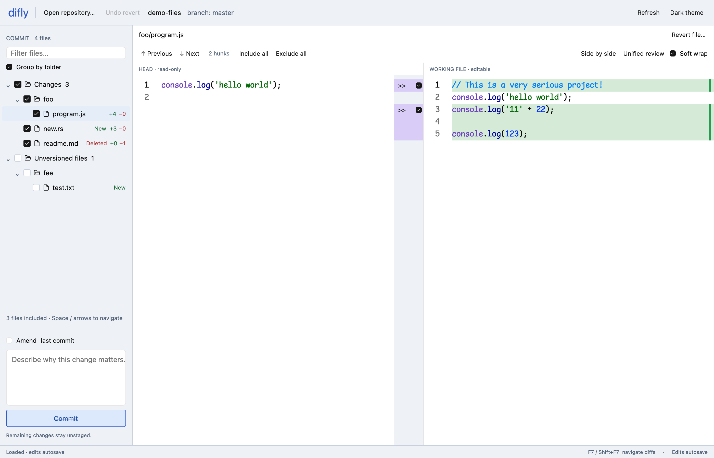

# Difly

A standalone Git commit dialog built in Rust with GPUI. Review editable diffs, select hunks,
commit or amend, and resolve merge conflicts.



## Install and run

```sh
brew install tommica/tap/difly       # latest tagged release
brew update && brew upgrade difly

difly /path/to/repository            # omit the path for the current repository
```

Build this checkout (the GPUI version) with a recent Rust toolchain and Git:

```sh
cargo install --locked --path .
difly
```

Git needs an author configured. macOS is tested locally; CI builds macOS, Linux and Windows.
The Homebrew release changes when a new version is published, not when this checkout changes.

## Controls

- Use arrows in the file tree and **Space** to toggle inclusion. Partial files/folders show **−**.
- Filter files or toggle **Group by folder**. Drag the dividers to resize panes.
- Use **F7 / Shift+F7** for the next/previous hunk. Check hunks to include them; **`>>`** reverts.
- Edits autosave. **Ctrl/Cmd+Z** undoes edits; **Ctrl/Cmd+R** redoes. **Undo revert** restores a revert.
- **Amend** chooses a recent commit; disabling it restores the original message draft.
- **Ctrl/Cmd+Enter** commits; **Ctrl/Cmd+O** opens another repository.
- Switch light/dark themes or soft wrap. Preferences and message drafts are saved in the system
  user configuration directory (`settings.json`; override with `DIFLY_CONFIG_DIR`).

Tracked changes start included; unversioned files start excluded. Remaining changes stay
unstaged after committing. During a merge, resolve conflicts and include all tracked changes.

Side-by-side supports editing; **Unified review** is read-only. The editable panes currently
use linked scroll offsets and do not insert blank rows to align unequal changes. Binary files
are whole-file changes. Finish rebases/cherry-picks through Git. Older-commit amend supports
linear history; conflicts leave the original branch unchanged.

## Development

```sh
bash scripts/create-demo.sh         # requires a new demo-files directory
cargo run -- demo-files
cargo test --locked --all-targets
# Optional native-window integration test (requires a graphical session):
cargo test --locked --features ui-tests --test ui_workflow
cargo clippy --locked --all-targets -- -D warnings
```

[Packaging notes](packaging/README.md).

## License

[BSD 3-Clause](LICENSE). Comic Mono uses its bundled [MIT license](assets/fonts/ComicMono-LICENSE.txt).
